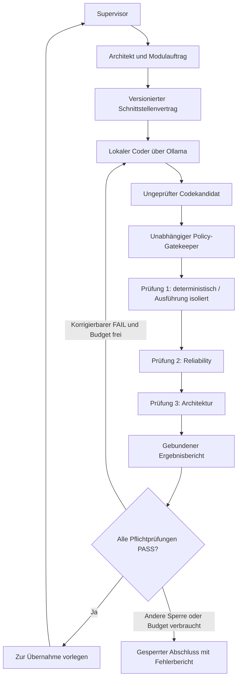

# Archi – Gesamtarchitektur

**Datei:** `01_Archi_Gesamtarchitektur.md`  
**Stand:** 20. Oktober 2026  
**Version:** 1.3 – kontrollierter Selbstverbesserungsloop ausdrücklich aufgenommen  
**Dokumentstatus:** Beschlossene Leitplanken mit ausdrücklich gekennzeichneten Umsetzungsvorschlägen und offenen Entscheidungen.  
**Implementierungsstatus:** Für Archi ist mit diesem Dokument keine Implementierung, Modellanbindung, wirksame Sandbox oder erfolgreiche Gesamtabnahme nachgewiesen.

## 1. Auftrag und Ziel

Archi soll eine kontrollierte Entwicklungs- und Prüfumgebung mit lokalem Coder werden. Ein Architekt erstellt den Gesamtplan und präzise Modulaufträge. Ein Schnittstellenvertrag legt Eingaben, Ausgaben, Fehlerfälle und Abnahmekriterien fest. Der lokale Coder erstellt jeweils einen klar abgegrenzten Baustein. Drei unabhängige Prüfschichten bewerten das Ergebnis. Ein begrenzter Korrekturablauf erlaubt höchstens zwei Nachbesserungen. Der Mensch bleibt Supervisor und entscheidet über freigabepflichtige Eingriffe.

Der lokale KI-Kern soll über Ollama auf der RTX 4080 arbeiten. Der vorgesehene Coder-Modellbetrieb muss ohne kostenpflichtige Modell-API und ohne zusätzlich erforderliches Abo auskommen. Externe MCP-Server, Tools, Skills und geeignete Dienste sind ausdrücklich zulässig. Es besteht keine pauschale Offline-Pflicht. Internetzugriff oder Serverkontakte sind für sich genommen kein Ausschlussgrund. Welche Daten ein externer Dienst erhält und welche Rechte ein Werkzeug besitzt, muss nachvollziehbar und begrenzt sein.

**BESCHLOSSEN:** Archi ist ein eigenständiges Projekt. Forge liegt nach der ausdrücklichen Entscheidung im Ausgangsgespräch auf Eis. Dieses Dokument beauftragt keine Arbeiten an Forge und übernimmt weder dessen Code noch dessen Betriebsfreigaben automatisch.

## 2. Wie Statusangaben zu lesen sind

Entscheidungsstatus und Nachweisstatus sind zwei getrennte Angaben.

| Entscheidungsstatus | Bedeutung |
|---|---|
| **BESCHLOSSEN** | Im aktuellen Auftrag ausdrücklich vorgegeben oder im Ausgangsgespräch eindeutig festgelegt. Für die weitere Planung bindend. |
| **VORGESCHLAGEN** | Fachlich begründete Konkretisierung. Noch keine bestätigte Produktwahl, Implementierung oder zusätzliche Befugnis. |
| **OFFEN** | Noch zu entscheiden oder anhand der tatsächlichen Umgebung zu klären. |

| Nachweisstatus | Bedeutung |
|---|---|
| **AKTUELL GEPRÜFT** | Im Rahmen der Dokumenterstellung unmittelbar beobachtet; nur im jeweils genannten Umfang. |
| **HISTORISCH BERICHTET** | Aus einem früheren Gespräch oder dort eingefügten Bericht übernommen; keine aktuelle Systemmessung. |
| **UNGEPRÜFT** | Hierfür liegt in dieser Arbeit kein ausreichender Funktions- oder Bestandsnachweis vor. |

Ein beschlossener lokaler Coder ist deshalb noch kein nachweislich laufender Coder. Eine gültige JSON-Ausgabe ist kein Beweis für richtigen Inhalt. Ein bestandener Einzeltest beweist keine funktionierende Gesamtarchitektur.

### 2.1 Beschlussregister

| ID | Status | Festlegung |
|---|---|---|
| B01 | BESCHLOSSEN | **Bestehendes vor Eigenentwicklung:** Zuerst geeignete fertige Gesamtlösungen prüfen; danach vorhandene Templates, Vorlagen, Workflows und Einzelbausteine. Nur belegte Lücken selbst entwickeln. |
| B02 | BESCHLOSSEN | Lokaler Coder über Ollama auf RTX 4080 als Zielarchitektur. Konkretes Modell und Laufzeitparameter bleiben offen. |
| B03 | BESCHLOSSEN | Cursor ist eine zu prüfende Oberfläche. Eine rein lokale Integration des eingebauten Cursor-Agenten wird nicht vorausgesetzt. |
| B04 | BESCHLOSSEN | Externe und lokale MCP-Server, Tools und Skills sind zulässig. Lokaler KI-Kern bedeutet keine vollständige Offline-Pflicht. |
| B05 | BESCHLOSSEN | Modulare Umsetzung mit Verträgen vor Implementierung und jeweils einer definierten Ziel-Datei pro Coder-Auftrag. |
| B06 | BESCHLOSSEN | Drei Prüfschichten: deterministische Prüfung, Reliability-Prüfung, Architekturprüfung. |
| B07 | BESCHLOSSEN | Erstimplementierung plus höchstens zwei Korrekturen; höchstens drei geprüfte Codeversionen pro Modulauftrag. |
| B08 | BESCHLOSSEN | Der Coder entscheidet nicht selbst über die endgültige Abnahme und darf seine Prüfgrundlagen nicht passend umschreiben. |
| B09 | BESCHLOSSEN | Vier Berechtigungsstufen unterscheiden Recherche, zugelassene Werkzeugnutzung, isoliertes Erproben und Produktiveingriffe. |
| B10 | BESCHLOSSEN | Eine Ausführungssandbox muss technisch isolieren. Ein Python-venv reicht dafür nicht. |
| B11 | BESCHLOSSEN | Berechtigungen werden außerhalb des Einflussbereichs von Coder und Orchestrator technisch durchgesetzt. |
| B12 | BESCHLOSSEN | Produktivänderungen, neue weitreichende Rechte und Kernupdates benötigen die Freigabe des Supervisors. |
| B13 | BESCHLOSSEN | Das Coder-Modell wird lokal betrieben; dafür sind keine kostenpflichtige Modell-API und kein zusätzliches Pflichtabo vorgesehen. Vollständiger Offlinebetrieb ist keine Anforderung. |
| B14 | BESCHLOSSEN | Wiederverwendung umfasst auch vorgefertigte Projekt- und Agenten-Templates, Prompts, Regelwerke, Testvorlagen, Integrationen, Konfigurationen und vollständige Abläufe. Geeignete vorhandene Lösungen übernehmen und konfigurieren, bevor dafür eigener Code entsteht. |
| B15 | BESCHLOSSEN | Archi benötigt einen kontrollierten Selbstverbesserungsloop: erzeugen, unabhängig prüfen, konkrete Fehler zurückmelden, gezielt überarbeiten und erneut prüfen. Erstversion plus höchstens zwei Korrekturen; geeignete fertige Workflows oder Templates dafür haben Vorrang vor Eigenentwicklung. |

**VORGESCHLAGEN:** Die fünf Dateien aus Abschnitt 6 beschreiben die Zuständigkeiten der ersten Ausbaustufe. Ihre Funktionen dürfen vollständig durch geeignete vorhandene Lösungen abgedeckt werden; fünf selbst entwickelte Dateien sind kein Pflichtziel. Ihre genaue API, die technische Sandbox-Lösung, der Policy-Baustein, die Modellidentität und die Details der Bedienoberfläche sind noch festzulegen.

## 3. Quellenlage und tatsächlicher Ausgangsstand

### 3.1 Abgleich des Gesprächs

Primäre Projektquelle ist der Chat [Drei Stufen Architektur](https://chatgpt.com/c/6ad7957a-9444-83ed-86ca-e21952d3efea). Der direkte Chat-Abruf lieferte nur fünf jüngste Gesprächsschritte und Inhaltsverweise für die Antworten. Über die Browseransicht konnten zusätzlich der Gesprächsanfang mit den fünf Modulen, die drei Prüfschichten, die Korrekturdefinition sowie spätere Klarstellungen zu externen Werkzeugen und Berechtigungen gelesen werden. Einige spätere Antworten waren auch dort nicht ladbar. Eine lückenlose Wiederherstellung aller früheren Antworttexte wird daher nicht behauptet.

Ergänzend wurde die bereits geöffnete Besprechung [Projektstart Archi: Bestandsaufnahme vorbereiten](https://gemini.google.com/app/2cc6a164aa120023) gelesen. Der dort eingefügte Übergabetext ist eine sekundäre Zusammenfassung. Seine pauschale Darstellung „ohne Cloud-Abhängigkeit“ wird durch die ausdrückliche Klarstellung im Originalgespräch eingeschränkt: Externe Dienste sind zulässig. Auch „Cursor ausschließlich als GUI“ ist kein Nachweis einer fertig eingerichteten lokalen Anbindung.

Die in diesem Dokument als **BESCHLOSSEN** bezeichneten Leitplanken stützen sich auf den aktuellen Auftrag und die erkennbaren Nutzerentscheidungen. Ergänzte Vertragsfelder, Abläufe und technische Produktempfehlungen sind **VORGESCHLAGEN**. Herstellerdokumentation belegt angebotene Funktionen, keine erfolgreiche Einrichtung auf diesem Rechner.

### 3.2 Bestands- und Nachweismatrix

| Gegenstand | Aussage | Nachweisstatus |
|---|---|---|
| Archi-Arbeitsbereich | Der oben genannte lokale Ordner wurde geprüft. Vor der Erstellung dieses Dokuments waren dort keine Einträge sichtbar. | AKTUELL GEPRÜFT |
| Versionsverwaltung | Der Ordner wurde nicht als Git-Repository erkannt. Für Archi sind hier deshalb kein Branch, Commit oder Remote festgestellt. | AKTUELL GEPRÜFT |
| Hardware | RTX 4080 mit 16 GB VRAM, Ryzen 7800X3D und 48 GB RAM werden im Ausgangsgespräch genannt. Die RTX 4080 ist außerdem aktuelle Zielvorgabe. | HISTORISCH BERICHTET; keine aktuelle Hardwaremessung |
| Betriebssystem/WSL | Windows 11 wird genannt. In der ergänzenden Besprechung steht ein eingefügtes Ergebnis: `Ubuntu-24.04`, WSL-Version 2, Zustand `Stopped`. | HISTORISCH BERICHTET |
| Docker | In derselben Besprechung wurde `docker` in der damaligen PowerShell nicht gefunden. Das beweist weder eine heutige Installation noch eine systemweite Abwesenheit. | HISTORISCH BERICHTET |
| Ollama | Als lokaler Modellserver vorgesehen; vorhandene Infrastruktur wird im Verlauf erwähnt. Endpoint, Dienstzustand, Modellliste und GPU-Belegung wurden für dieses Dokument nicht geprüft. | UNGEPRÜFT |
| Guardrails AI, DeepEval, Promptfoo | Als vorhandene oder einzubindende Bausteine genannt; Guardrails AI 0.11.0 erscheint im Gespräch. Aktuelle Interpreter, Installationen, Versionen und Archi-Anbindungen sind nicht festgestellt. | HISTORISCH BERICHTET / UNGEPRÜFT |
| Cursor | Kandidat für Editor und Bedienoberfläche. Lokale Konfiguration und ein durchgehender Archi-Ablauf wurden nicht geprüft. | UNGEPRÜFT |
| Fünf Module | Im Ausgangsgespräch vorgeschlagene Dateigrenzen. Keine davon war im geprüften Archi-Ordner vorhanden. | Entwurf; keine Implementierung nachgewiesen |
| Gatekeeper/Sandbox | Verbindliche Anforderungen. Wirksame Rechtebegrenzung und Isolation sind nicht nachgewiesen. | UNGEPRÜFT |
| Laufende Prozesse/Automationen | Für Archi wurden keine Prozesse oder Automationen inventarisiert. Daraus folgt keine Aussage, dass keine existieren. | UNGEPRÜFT |

Diese Dokumentarbeit umfasste Quellenrecherche, Lesen vorhandener Gesprächsinhalte und lokale Dateiprüfung. Sie umfasste keine Installation, keinen Modelllauf, keinen Sandbox-Start und keine Änderung an Laufzeit-, Netzwerk- oder Sicherheitskonfigurationen.

## 4. Oberste Regel: Bestehendes vor Eigenentwicklung

**BESCHLOSSEN:** Vor einer neuen Komponente oder Installation gilt folgende Reihenfolge:

1. Die konkrete Anforderung und ihre Abnahmekriterien verstehen.
2. Den tatsächlichen Bestand mit Pfaden, Versionen und Nutzungsgrenzen erfassen.
3. Zuerst fertige Gesamtlösungen und vorgefertigte vollständige Abläufe recherchieren. Danach geeignete Projekt-/Agenten-Templates, Prompt- und Regelvorlagen, Testvorlagen, Konfigurationen, Integrationen, Standardbibliothek, Programme, Frameworks, MCP-Server, Tools und Skills prüfen.
4. Die Eignung anhand von Fähigkeiten, Einschränkungen, Datenfluss, Rechten, Wartung, Lizenz/Kosten und Integrationsaufwand beurteilen.
5. Eine begründete Lösung auswählen. Höchstens drei geeignete Vorschläge mit Pro und Contra gegenüberstellen, wenn eine Wahl erforderlich ist.
6. Geeignete vorhandene Lösungen übernehmen und konfigurieren. Nur für eine danach belegte Restlücke eine möglichst kleine eigene Ergänzung entwickeln. Keine eigenen Wrapper allein zur Einhaltung vorgeschlagener Dateinamen bauen.
7. Einen gezielten Funktionstest planen. Weitere Vergleiche nur bei neuen entscheidenden Erkenntnissen oder einem konkreten Fehler.

**BESCHLOSSEN:** Diese Reihenfolge gilt für die gesamte Archi-Umgebung einschließlich Oberfläche, Agentenablauf, Prüfungen, Korrekturschleife, Berechtigungsdurchsetzung und Sandbox. Ein fertiger geeigneter Gesamtaufbau hat Vorrang vor dem Zusammenbauen eigener Module. Ein Template mit ähnlichem Namen gilt erst nach dem Anforderungsabgleich als geeignet. Die lokale kostenlose Coder-Modellnutzung, drei unabhängigen Prüfschichten, höchstens zwei Korrekturen und technischen Berechtigungsgrenzen bleiben die Abnahmekriterien.

Ein vorhandener Produktname genügt nicht als Eignungsnachweis. Umgekehrt rechtfertigt eine andere API allein keinen eigenen Framework-Nachbau. Das im Gespräch genannte Python-Modul `ast` ist beispielsweise bereits Teil der Standardbibliothek; seine Verwendung ist keine Paketinstallation.

**VORGESCHLAGEN:** Jede Wiederverwendungsentscheidung erhält eine kurze Notiz mit Anforderung, geprüfter Quelle/Version, Ergebnis, verbleibender Lücke und Begründung. Ob hierfür eine bestehende Projektverwaltung genügt, wird vor der Entwicklung einer eigenen Registry geprüft.

## 5. Rollen, Vertrauensgrenzen und Gesamtablauf

Die ursprünglichen drei Arbeitsstufen bleiben erhalten:

1. **Architekt:** Gesamtplan, Modulauftrag und Akzeptanzkriterien erstellen.
2. **Schnittstellenvertrag:** Datenformate, Fehlerfälle, Abhängigkeiten und erlaubte Änderungen festlegen.
3. **Lokaler Handwerker:** Den begrenzten Auftrag mit Ollama umsetzen.

Die drei **Prüfschichten** aus Abschnitt 8 und die vier **Berechtigungsstufen** aus Abschnitt 10 sind andere Einteilungen. Sie ersetzen diese Arbeitsstufen nicht.

Das Diagramm ist ein **VORGESCHLAGENER** Ablauf, kein Nachweis vorhandener Komponenten. Der Gatekeeper prüft außerdem jeden Werkzeug- und Übernahmeantrag; seine Darstellung an einer Stelle bedeutet keine Beschränkung auf diesen Übergang.

| Rolle/Komponente | Verantwortung | Grenze |
|---|---|---|
| Supervisor | Ziele, Grenzen, freigabepflichtige Änderungen und Abweichungen entscheiden. | Eine Freigabe bezieht sich auf einen konkreten Umfang. |
| Architekt | Modulgrenzen, Verträge, Abnahmekriterien und Architekturreview. | GPT-Unterstützung ist möglich; externe Datenübertragung bleibt ein eigener Datenfluss. |
| Lokaler Coder | Kandidat und gezielte Korrekturen für die eine beauftragte Datei erzeugen. | Keine eigenen Rechteerweiterungen oder Abnahmeentscheidungen. |
| Orchestrator | Reihenfolge, Auftragszustand und Korrekturbudget verwalten. | Darf seine Aktionen beantragen, aber keine eigene Policy umgehen. |
| Policy-Gatekeeper | Aktion, Identität, Rechte, Zielpfad und Freigabe vor Ausführung prüfen. | Muss technisch außerhalb des Einflussbereichs des Agenten liegen. |
| Unabhängiger Prüfprozess | Eingefrorene Prüfgrundlagen auf den gebundenen Kandidaten anwenden. | Vertraut weder Selbstbericht noch Testergebnis des Coders ungeprüft. |
| Sandbox-Ausführer | Unvertrauenswürdigen Code und Paketinstallationen begrenzt ausführen. | Kein allgemeiner Zugriff auf Host, Produktivprojekt oder Geheimnisse. |
| Cursor | Editor, Anzeige und möglicherweise Zugang zu einem bestehenden lokalen Client. | Kein Sicherheitsanker und keine vorausgesetzte lokale Modellintegration. |

Ein separater Prozess allein beweist keine Trennung: Benutzerkonten, Dateirechte, Dienstberechtigungen und erreichbare Schnittstellen müssen verhindern, dass der Agent den Gatekeeper, seine Regeln oder die Prüfgrundlagen verändert. Die konkrete Umsetzung ist **OFFEN**.

## 6. Die fünf vorgeschlagenen Module

**Status des gesamten Abschnitts: VORGESCHLAGEN.** Die Dateinamen stammen aus dem Ausgangsgespräch. Sie bezeichnen geplante Zuständigkeiten, keine bereits vorhandenen Implementierungen. Geeignete fertige Lösungen, Templates und Workflows dürfen diese Zuständigkeiten vollständig abdecken und ihre vorhandene Dateistruktur behalten. Erst eine belegte funktionale Lücke rechtfertigt eigene Dateien oder Adapter. Insbesondere ist die JSON-Datei ein Regelartefakt und kein ausführbares Python-Modul.

| Nr. | Vorgeschlagene Datei relativ zur künftigen Projektwurzel | Aufgabe |
|---|---|---|
| M1 | `model_client.py` | Begrenzte, robuste Verbindung zu Ollama. |
| M2 | `knowledge/project_constraints.json` | Versionierte Projektvorgaben und bindende Auftragsgrenzen. |
| M3 | `validators/guardrails_adapter.py` | Konfigurierte Regelprüfungen und Guardrails-Ergebnisse vereinheitlichen. |
| M4 | `validators/deepeval_adapter.py` | Semantische Bewertung über ausdrücklich konfiguriertes Evaluierungsmodell. |
| M5 | `core/correction_loop.py` | Auftragsablauf und maximal zwei Korrekturen steuern. |

### 6.1 M1 – `model_client.py`

**Eingaben:** Freigegebene Modellidentität, geprüfter Endpoint, versionierter Auftrag, ausgewählte Kontextdateien, erwartetes Ausgabeschema sowie feste Zeit- und Ausgabebudgets.

**Ausgaben:** Modellantwort als zunächst ungeprüfter Kandidat; dazu technische Metadaten und eindeutige Fehlerangaben. Tool-Aufrufe des Modells sind nur Anträge an den Gatekeeper.

**Verantwortung:** Native Ollama-API oder einen nachgewiesen passenden bestehenden Client verwenden; Timeouts, Verbindungsfehler, ungültige Antworten und fehlende Fähigkeiten sauber melden. Strukturierte Ausgaben anfordern und anschließend separat validieren. Gesprächszustand und Kontextzuordnung nachvollziehbar halten.

**Grenzen:** Keine selbstständige Paketinstallation, kein automatischer Wechsel auf einen externen Modellanbieter, keine Shell-Ausführung und keine implizite Freigabe aus einer Modellantwort.

**Abnahme:** Ein begrenzter realer Auftrag mit festem Modell und Kontext; zusätzlich gezielte Fehlerfälle für Nichterreichbarkeit, Timeout und Schemafehler. Ein API-Stub allein bestätigt keine funktionierende Ollama-Anbindung.

### 6.2 M2 – `knowledge/project_constraints.json`

**Inhalt:** Projekt- und Vertragsversion, verbindliche Regeln mit Regel-IDs, erlaubte Änderungsdatei, zugelassene Werkzeuge, Datenklassen, Berechtigungsprofil, Korrekturgrenze sowie Verweise auf die unabhängigen Prüfgrundlagen.

**Verantwortung:** Regeln maschinenlesbar und eindeutig halten. Fehlende Pflichtregeln oder widersprüchliche Grenzen führen zu einer Sperre, nicht zu einer freien Interpretation durch das Modell.

**Grenzen:** JSON speichert Vorgaben, setzt sie aber nicht selbst durch. Freigaben, Zugangsdaten und technische Host-Policy werden nicht durch vom Coder bearbeitbare Felder ersetzt. Das Regelartefakt bleibt während eines Coder-Auftrags schreibgeschützt.

**Abnahme:** Schema, Pflichtfelder, zulässige Werte und Widersprüche prüfen. Zusätzlich nachweisen, dass verbotene Aktionen tatsächlich verhindert werden; ein gültiges Regelartefakt genügt dafür nicht.

### 6.3 M3 – `validators/guardrails_adapter.py`

**Eingaben:** Unveränderter Kandidat, Kandidaten-Hash, Vertrags- und Regelversion, ausgewählte Validatoren und benötigte Belegstellen.

**Ausgaben:** Regelbezogene Ergebnisse mit Status, Begründung, Fundstelle und technischem Fehlerzustand. Rohantworten von Modellen bleiben als solche erkennbar.

**Verantwortung:** Vorhandene Guardrails-Funktionen und passende deterministische Prüfungen verwenden. Unterscheiden, ob eine Regel deterministisch, durch ein zusätzliches Modell oder durch einen externen Dienst geprüft wird. Guardrails ist nicht pauschal deterministisch.

**Grenzen:** Keine Freigabe gegen einen negativen Host- oder Testbefund. Keine versteckten Reasks oder automatischen Reparaturen außerhalb des gemeinsamen Korrekturbudgets. Validatoren können eigene Abhängigkeiten oder Modelle benötigen; diese müssen vorab erfasst sein.

**Abnahme:** Bekannte Regelverletzungen werden erkannt, gültige Gegenbeispiele nicht pauschal verworfen, technische Ausfälle als `ERROR` gemeldet. Die konkret verwendeten Regeln müssen zum Archi-Auftrag passen.

### 6.4 M4 – `validators/deepeval_adapter.py`

**Eingaben:** Auftrag und Akzeptanzkriterien, Kandidat, erforderliche Quellen/Trace-Daten, konkrete Metrik, festgelegter Schwellenwert und explizite Judge-Konfiguration.

**Ausgaben:** Metrik, Score, Schwellenwert, Urteil, Begründung, Modellidentität und belegbezogene Hinweise; bei fehlenden Voraussetzungen ein ausdrücklicher Nichtnachweis oder technischer Fehler.

**Verantwortung:** Geeignete vorhandene Metriken für Auftragsbezug und Aufgabenerfüllung prüfen. Im Gespräch genannte Begriffe wie „Prompt Alignment“ und „Task Completion“ sind Prüfziele; eine passende konkrete API/Metrik und ihre erforderlichen Eingaben sind vor Implementierung zu bestätigen.

**Grenzen:** DeepEval verwendet bei vielen Metriken standardmäßig einen externen Judge. Für den geplanten lokalen Bewertungsweg muss das Modell ausdrücklich konfiguriert werden. Ein lokaler Judge ist fehlbar; sein Score beweist keine fachliche Wahrheit und darf deterministische Fehler nicht überstimmen. [DeepEval: FAQ](https://deepeval.com/docs/faq)

**Abnahme:** Ein klar begrenztes Set aus bekannten positiven und negativen Fällen sowie ein realer Archi-Fall. Reine Schemafähigkeit oder ein synthetischer Score belegen keine allgemeine Bewertungsqualität.

### 6.5 M5 – `core/correction_loop.py`

**Eingaben:** Eingefrorener Modulauftrag, unveränderliche Prüfgrundlagen, ursprüngliche Kandidatenversion und strukturierte Fehlerberichte.

**Ausgaben:** Vollständige Versionsfolge mit Erstversuch und höchstens zwei Korrekturen; abschließender Prüfbericht, Freigabevorlage oder gesperrter Abschluss.

**Verantwortung:** Zustände und Budget zentral führen; jede neue Version an denselben Auftrag binden; nach Korrekturen erneut die vollständige erforderliche Prüfkette durchlaufen. Bei Abbruch, Wiederaufnahme oder Prozessneustart darf das Budget nicht stillschweigend zurückgesetzt werden.

**Grenzen:** Keine Änderung von Tests, Schwellenwerten, Regeln, Rechteprofil oder Zielauftrag, um einen Kandidaten passend zu machen. Keine eigene Berechtigungsdurchsetzung anstelle des unabhängigen Gatekeepers.

**Abnahme:** Erfolg im Erstversuch, Erfolg nach Korrektur, fortbestehender Fehler nach zweiter Korrektur, Prüferausfall und Wiederaufnahme mit erhaltenem Budget gezielt prüfen.

### 6.6 Notwendige Infrastruktur außerhalb der fünf Dateigrenzen

Die fünf Dateien allein bilden noch kein lauffähiges Gesamtsystem. Benötigt werden unter anderem ein sicherer Auftragskanal, unabhängiger Prüfprozess, Policy-Durchsetzung, Sandbox-Steuerung, Ergebnisablage und Übernahmeverfahren. **OFFEN** ist, welche bestehenden Werkzeuge dies bereits abdecken. Die Aufzählung ist kein Auftrag, dafür weitere eigene Frameworks oder MCP-Server zu entwickeln.

## 7. Gemeinsame Schnittstellen und Ergebnisvertrag

**BESCHLOSSEN:** Verträge und Fehlerzustände stehen vor der Implementierung. `PASS`, `FAIL` und `ERROR` müssen unterscheidbar sein. Ein Prüferabsturz darf niemals als Erfolg gelten.

**VORGESCHLAGEN:** Die folgenden Angaben bilden den gemeinsamen Ergebnisvertrag. Konkretes JSON-Schema und Datentypen sind noch festzulegen.

| Bereich | Erforderliche Angaben |
|---|---|
| Auftrag | `task_id`, Modul/Zieldatei, Vertragsversion, Hash der Regeln und Prüfdefinitionen, Ausgangssnapshot. |
| Kandidat | Versionsnummer 0/1/2, Hash des tatsächlich geprüften Inhalts, geänderte Pfade, zugehöriger Ursprungsauftrag. |
| Modell | Coder- bzw. Judge-Identität, verfügbare Versions-/Digest-Angabe, relevante Parameter und Provider. |
| Prüfschicht | Schicht-ID, Prüfer-/Werkzeugversion, Eingaben, Status, Befunde, Belegreferenzen, Zeitpunkt. |
| Ausführung | Umgebung/Abbildversion, Start und Ende, Exit-Code, Ressourcen-/Timeoutbefund, Referenz auf begrenzte Rohlogs. |
| Korrekturen | Zentraler Zähler, vorangehender Befund, korrigierte Version und verbleibendes Budget. |
| Rechte | Beantragte Aktion, tatsächliches Rechteprofil, Entscheidung und erforderliche Freigabereferenz. |
| Abschluss | Gesamtstatus, offene Risiken, nicht ausgeführte Prüfungen, Supervisor-Entscheidung und Übernahmezustand. |

Hash und Zeitstempel binden Belege an Inhalte; sie beweisen allein keine Echtheit. Prüfergebnisse müssen aus dem kontrollierten Prüfprozess stammen. Ein vom Coder ausgegebenes JSON mit `PASS` ist keine vertrauenswürdige Prüfbescheinigung.

| Prüfstatus | Bedeutung | Konsequenz |
|---|---|---|
| `PASS` | Die benannte Prüfung wurde vollständig ausgeführt und ihre Kriterien wurden erfüllt. | Nur diese konkrete Prüfung ist positiv. |
| `FAIL` | Eine Prüfung ergab eine belegte Abweichung. | Keine Abnahme; gegebenenfalls begrenzte Korrektur. |
| `ERROR` | Die Prüfung scheiterte technisch, etwa durch Timeout, fehlende Abhängigkeit oder Prüferabsturz. | Keine Abnahme; Ursache getrennt behandeln. |
| `UNVERIFIED` | Erforderlicher Nachweis fehlt oder die Prüfung wurde nicht ausgeführt. | Keine Abnahme. Vorgeschlagene Ergänzung des ursprünglichen Vertrags. |

**VORGESCHLAGEN:** Die Gesamtbewertung nennt vorhandene `FAIL`- und `ERROR`-Befunde nebeneinander, statt sie zu einem irreführenden Score zu verrechnen. Nur wenn alle vorgeschriebenen Prüfungen für denselben Kandidaten `PASS` melden und keine Sperre besteht, entsteht eine Freigabevorlage. Das bedeutet noch keine Übernahme in die Produktivumgebung.

Wird nach der Prüfung Code, Regelwerk, Vertrag oder Testgrundlage geändert, gilt der alte Bericht nicht automatisch für den neuen Stand. Die erforderlichen Prüfungen richten sich nach der tatsächlichen Änderung und müssen neu zugeordnet werden.

## 8. Drei unabhängige Prüfschichten

### 8.1 Schicht 1 – deterministischer Prüfstand

**BESCHLOSSEN:** Syntax, definierte Schnittstellen, Typen, Importierbarkeit und abgedecktes Verhalten prüfen. Im Gespräch genannte bestehende Bausteine sind `pytest`, Ruff und mypy; die konkrete Auswahl und Version sind **OFFEN**.

**VORGESCHLAGEN:** Statische Prüfungen zuerst, notwendige dynamische Tests ausschließlich in der zugelassenen Ausführungsumgebung. Bereits ein Import kann Projektcode ausführen; Importtests und Tests mit fremden Plugins gehören deshalb ebenfalls in die Sandbox. Auch Parser und Analysewerkzeuge laufen mit begrenzten Rechten und Ressourcen.

Tests prüfen nur die tatsächlich enthaltenen Fälle. Ruff ist ein Linter, mypy ein Typprüfer, pytest ein Testframework. Keines dieser Werkzeuge allein beweist fachliche Richtigkeit, Nebenwirkungsfreiheit oder wirksame Isolation.

### 8.2 Schicht 2 – Reliability-Prüfung

**BESCHLOSSEN:** Projektvorgaben, Vertragskonformität und Antwortqualität unabhängig vom Selbsturteil des Coders prüfen. Guardrails AI und DeepEval sind vorgesehene Integrationskandidaten.

Deterministische Regeln und modellgestützte Bewertungen erhalten getrennte Ergebnisse. Eine Aussage wie „Fehlerbehandlung fehlt“ benötigt eine konkrete Fundstelle und die zugehörige Anforderung. Ein unbelegter Judge-Verdacht wird als solcher behandelt; er ist keine nachgewiesene Codeeigenschaft.

**VORGESCHLAGEN:** Promptfoo für gezielte Regressionen bei Änderungen an Prompts, Regeln oder Prüflogik einsetzen. Es ist ein ergänzendes Evaluierungswerkzeug innerhalb der Prüfarchitektur, keine automatisch unabhängige vierte Instanz. Es unterstützt deterministische und modellgestützte Assertions. [Promptfoo: Assertions and Metrics](https://www.promptfoo.dev/docs/configuration/expected-outputs/)

Lokale Zielinferenz beweist keinen vollständig lokalen Evaluierungslauf: Judge-, Angriffsgenerierungs- und sonstige Provider müssen separat kontrolliert werden. Promptfoo dokumentiert beispielsweise mögliche Remote-Generierung im Red-Team-Ablauf. [Promptfoo: Red team configuration](https://www.promptfoo.dev/docs/red-team/configuration/)

### 8.3 Schicht 3 – Architekturreview

**BESCHLOSSEN:** Modulgrenzen, Schnittstellen, Abhängigkeiten, Wiederverwendung und Gesamtplan prüfen. Die Rolle übernimmt der Architekt, gegebenenfalls mit GPT-Unterstützung; der Nutzer bleibt Supervisor.

Die bloße Meldung „alle Tests bestanden“ reicht nicht. Benötigt werden mindestens Kandidatenbindung, Vertragsversion, die Ergebnisse der vorherigen Schichten, Korrekturzahl, Abweichungen und verbleibende Risiken. Für eine belastbare Schnittstellenprüfung müssen die relevanten Vertrags- und Codestellen zugänglich sein. Bei Unklarheiten ist konkreter Code einzusehen.

**OFFEN:** Welche Modellunterstützung diese Rolle erhält und welche Projektinformationen dafür extern verarbeitet werden dürfen. Ein Cloud-Architekt ist kein lokaler Prüfer.

### 8.4 Was Unabhängigkeit hier verlangt

**BESCHLOSSEN:** Der Coder kann die Prüfungen weder abschalten noch ihre Kriterien verändern. Tests, Regeln und Verträge werden vor dem Lauf festgelegt und für ihn geschützt. Der unabhängige Prüfprozess erzeugt den Bericht.

**VORGESCHLAGEN:** Getrennte Schreibrechte, klar identifizierte Prüfer und getrennte Belege je Schicht. Die drei Schichten dürfen keine lediglich kopierten Selbstbewertungen desselben Coder-Dialogs sein. Ein anderes Modell kann Fehlerkorrelation verringern, schafft aber allein keine technische Unabhängigkeit. Eine konkrete Modell- und Prozessaufteilung ist noch nicht nachgewiesen.

Bei der Entwicklung des Prüfsystems selbst werden dessen Änderungen als gesonderter Auftrag unabhängig geprüft. Der Coder darf nicht im gleichen Auftrag seinen Kandidaten und die für dessen Abnahme geltenden Regeln verändern.

## 9. Selbstverbesserungsloop: höchstens zwei Nachbesserungen

**BESCHLOSSEN:** Eine Erstimplementierung plus maximal zwei gezielte Korrekturen. Die Grenze gilt gemeinsam für den Modulauftrag, nicht erneut pro Prüfschicht oder Framework.

| Version | Bedeutung | Weitere Korrektur möglich? |
|---|---|---|
| 0 | Erstimplementierung | Ja, höchstens zwei. |
| 1 | Erste Korrektur | Ja, höchstens eine. |
| 2 | Zweite Korrektur | Nein. Bei weiterem Fehler gesperrter Abschluss. |

Nach einer Korrektur wird die gesamte erforderliche Prüfkette erneut durchlaufen. Eine vorherige Prüfschicht kann erneut fehlschlagen; ihr altes `PASS` gilt nicht automatisch für geänderten Inhalt.

**VORGESCHLAGENE Ablaufdetails:**

1. Auftrag, Zieldatei, Regeln, Tests und Budgets einfrieren.
2. Kandidatenversion erzeugen und ihren Inhalt binden.
3. Aktionen durch den Gatekeeper prüfen lassen; Prüfkette durchführen.
4. Bei vollständigem `PASS` einen Bericht zur Freigabe vorlegen.
5. Bei belegtem, korrigierbarem `FAIL` einen konkreten Fehlerbericht an den Coder geben und den zentralen Zähler erhöhen.
6. Bei `ERROR` oder `UNVERIFIED` keine Codeänderung auf Verdacht erzwingen. Die technische Ursache oder fehlende Voraussetzung zuerst klären.
7. Bei verbrauchtem Budget, Sicherheitsverstoß oder erforderlicher Auftragsänderung kontrolliert stoppen und den Stand erhalten.

Ein zusätzlicher Code-Generierungsversuch aufgrund ungültiger Modellantworten ist kein kostenloser Neustart. Framework-interne Reasks und Reparaturen müssen deaktiviert oder in dieselbe Obergrenze eingebunden werden. Technische Wiederholungen ohne neue Codeversion benötigen ein eigenes begrenztes Budget; sie dürfen keine Endlosschleife oder zusätzliche Kandidaten verstecken. Konkrete Timeout- und Wiederholungswerte sind **OFFEN**.

Die Zwei-Korrekturen-Grenze beschränkt keine sachlich erforderliche Recherche nach vorhandenen Lösungen. Sie autorisiert auch keine Installation oder Rechteausweitung. Ein nach zwei Korrekturen gesperrter Auftrag wird nicht durch Umbenennung oder Neustart automatisch fortgesetzt.

### 9.1 Verbindlicher Selbstverbesserungsablauf innerhalb eines Auftrags

**BESCHLOSSEN:** Der Ablauf soll automatisch zwischen Coder und unabhängigem Prüfsystem stattfinden, ohne dass der Nutzer Fehlermeldungen von Hand kopieren muss. Zum Fehlerfeedback gehören die tatsächlich geprüfte Kandidatenversion, die konkrete Regel oder der fehlgeschlagene Test und die relevanten Belege. Der lokale Coder überarbeitet damit seinen Entwurf. Anschließend wird der neue Kandidat wieder unabhängig geprüft. Nach vollständigem Bestehen endet die Schleife mit einer Freigabevorlage; bei verbrauchtem Budget endet sie gesperrt mit Bericht.

Die Veränderung darf ausschließlich den freigegebenen Auftragsumfang betreffen. Coder und Selbstverbesserungsworkflow dürfen Tests, Qualitätsmaßstäbe, Berechtigungen, Korrekturgrenze oder Sandbox nicht abschwächen. Interne Reparaturaufrufe vorhandener Frameworks zählen zum gleichen Gesamtbudget. Eine positive Selbsteinschätzung des Coders ersetzt keine Prüfschicht.

**OFFEN:** Welcher vorhandene Agentenworkflow oder welches Template diesen Ablauf einschließlich der Budget- und Rechteanforderungen abdeckt. Der Begriff „Self-Improvement“ allein ist kein Eignungsnachweis. Die Anforderung ist beschlossen; eine funktionierende Umsetzung wird damit nicht behauptet.

### 9.2 Verbesserungen über mehrere Aufträge hinweg

**VORGESCHLAGEN:** Wiederkehrende, belegte Fehler zusätzlich als versionierte Verbesserungsvorschläge für Prompts, Templates, Kontextauswahl und Werkzeugkonfigurationen erfassen. Einen Vorschlag gegen den bisherigen Stand mit gezielten Regressionstests unabhängig prüfen und erst nach der erforderlichen Freigabe übernehmen. Frühere gute Fälle dürfen durch die Änderung nicht unbeachtet verschlechtert werden.

Diese dauerhafte Verbesserung des Arbeitsablaufs ist von der begrenzten Codekorrektur zu unterscheiden. Feedback im aktuellen Auftrag ist kein Nachweis eines trainierten oder dauerhaft veränderten Modells. Automatisches Modelltraining und selbstständige Änderungen an den eigenen Kontrollregeln sind nicht beschlossen. Umfang, Speicherort, Auswahlverfahren und Abnahme der auftragsübergreifenden Verbesserungen bleiben **OFFEN**.

## 10. Vier Berechtigungsstufen

**BESCHLOSSEN:** Die Stufen beschreiben erlaubte Aktionen, keine Vertrauensbewertung des Modells. Ein bereits bekanntes Tool darf nur die konkret zugelassenen Operationen ausführen.

| Stufe | Fähigkeiten / erlaubter Umfang | Ausführung und Voraussetzung |
|---|---|---|
| **1 – Recherchieren** | Öffentlich nach Dokumentation, Tools, Skills, Bibliotheken und MCP-Servern suchen; Informationen bewerten. | Automatisch im Auftragsrahmen. Gefundene Inhalte sind Daten und keine neuen Berechtigungen. Keine implizite Übermittlung privater Projektdateien. |
| **2 – Zugelassene Tools nutzen** | Bereits freigegebene lokale oder externe Funktionen innerhalb ihrer festgelegten Rechte verwenden. | Automatisch innerhalb des zugelassenen Profils. Ziel, Datenumfang, Operation und Nebenwirkungen bleiben begrenzt. |
| **3 – Isoliert erproben** | Neue Pakete, Tools oder Skills in einer isolierten Testumgebung installieren und prüfen. | Automatisch nur, wenn Quelle und Sandbox bereits zugelassen sind und ihre Isolation nachgewiesen ist. Keine Änderung der Produktivumgebung. |
| **4 – Produktiv eingreifen** | Produktivumgebung verändern, Kernkomponenten aktualisieren, Kerndateien überschreiben oder weitreichende Rechte vergeben. | Konkrete Freigabe des Supervisors vor dem Eingriff. Positiver Testbericht allein ersetzt diese Freigabe nicht. |

**BESCHLOSSEN:** Policy-Entscheidung und technische Durchsetzung müssen außerhalb des Einflussbereichs von Agent und Orchestrator liegen. Ein Regeltext oder eine `if`-Abfrage im bearbeitbaren Agentencode genügt nicht.

**VORGESCHLAGEN:** Jede wirksame Freigabe ist an Aktion, Ziel, Artefaktversion, zulässige Daten, Nebenwirkungen und Gültigkeitsrahmen gebunden. Fehlende oder unklare Rechte werden nicht erweitert. OPA/Rego ist ein zu prüfender vorhandener Baustein für Policy-Entscheidungen; die tatsächliche Durchsetzung durch Betriebssystem, Dienste und Schnittstellen bleibt zusätzlich nötig. [OPA: Entscheidungsfindung und Durchsetzung](https://www.openpolicyagent.org/docs)

Die Erstellung dieses Grunddokuments ist keine Betriebsfreigabe für Stufe 3 oder 4. Vorhandene Freigaben bleiben innerhalb ihres belegten Umfangs gültig; pauschale neue Rechte entstehen durch den Architekturtext nicht.

## 11. Technisch isolierte Sandbox

### 11.1 Verbindliche Anforderung

**BESCHLOSSEN:** Paketisolierung, Testumgebung und Ausführungsisolation sind zu trennen. Ein `venv` trennt Python-Paketumgebungen; es stellt keine Betriebssystemgrenze für Datei-, Netzwerk- oder Prozesszugriff her. Das ist eine Architekturfolgerung aus seinem dokumentierten Funktionsumfang. [Python: venv](https://docs.python.org/3/library/venv.html)

Unvertrauenswürdiger Code darf weder Produktivdateien verändern noch unkontrolliert Netzwerk, Geheimnisse, Hostverwaltung oder Tool-Server erreichen. Die Durchsetzung muss auch dann gelten, wenn Code, Paketinstallationsskript oder Skill absichtlich davon abweicht. Ein statischer Scan oder bestandener Funktionstest ersetzt diese Grenze nicht.

### 11.2 Auswahl mit Pro und Contra

**VORGESCHLAGENE ENTSCHEIDUNG:** Eine dedizierte Hyper-V-VM als bevorzugte Ausführungsgrenze untersuchen. Ollama und die vertrauenswürdige Steuerung bleiben außerhalb. Die VM benötigt für normale Python-Modultests keinen eigenen Modelllauf und damit zunächst keine GPU-Durchreichung. Ob diese Wahl zur tatsächlichen Windows-Edition und Ressourcenlage passt, ist **OFFEN**.

| Vorschlag | Fähigkeiten / Pro | Contra und Voraussetzungen | Einordnung |
|---|---|---|---|
| **1. Dedizierte Hyper-V-VM** | Eigenes Gastbetriebssystem; getrennt verwaltete Laufzeit; kontrollierbare Geräte und Netzwerkanbindung; reproduzierbarer Ausgangsstand möglich. | Unterstützte Windows-Edition, Virtualisierung und ausreichende Ressourcen erforderlich; Einrichtung und Pflege aufwendiger. GPU im Gast ist nicht automatisch verfügbar. | Bevorzugter Vorschlag für die Ausführung fremden/generierten Codes. |
| **2. Docker Desktop mit WSL2** | Reproduzierbare Linux-Umgebungen, gezielte Mounts, Ressourcenlimits und deaktivierbares Containernetzwerk. | WSL2-Distributionen teilen einen Linux-Kernel. Mounts, Engine-Zugriff und privilegierte Container können Grenzen öffnen. Docker nennt für strengere Isolation das Hyper-V-Backend; optionale ECI-Funktionen haben eigene Voraussetzungen. | Geprüfte Alternative bzw. Paketierung innerhalb einer geeigneten Ausführungsgrenze. Nicht ohne konkretes Sicherheitsprofil als gleichwertig annehmen. |
| **3. Windows Sandbox** | Hypervisorbasierte Kernelisolation; temporäre Windows-Tests; konfigurierbare Netz- und Gerätefreigaben. | Netzwerk ist standardmäßig aktiv; Zustand geht beim Schließen verloren. Für dauerhaft reproduzierbare Automatisierung muss die Einrichtung eigens bewertet werden. | Ergänzung für einzelne Windows-Kompatibilitätstests. |

Quellen: [Microsoft: Hyper-V-Voraussetzungen](https://learn.microsoft.com/en-us/windows-server/virtualization/hyper-v/host-hardware-requirements), [Docker: Isolationsgrenzen unter WSL2](https://docs.docker.com/desktop/enterprise/hardened-desktop/enhanced-container-isolation/limitations/), [Microsoft: Windows Sandbox](https://learn.microsoft.com/en-us/windows/security/application-security/application-isolation/windows-sandbox/).

Die Bevorzugung der dedizierten VM ist eine fachliche Einschätzung anhand der geforderten Vertrauensgrenze. Sie ist weder eine bereits getroffene Nutzer-Produktentscheidung noch eine Sicherheitsgarantie. Ein Name wie „Docker“, „WSL2“ oder „Sandbox“ beweist keine passende Konfiguration.

### 11.3 Vorgeschlagenes Mindestprofil

**VORGESCHLAGEN:** Vor produktiver Nutzung verbindlich konkretisieren und gezielt nachweisen:

- Eigene unprivilegierte Ausführungsidentität; keine Host-Administrationsrechte oder Zugangsdaten.
- Keine vollständigen Hostlaufwerke, Benutzerprofile oder Produktivprojektwurzeln freigeben. Nur benötigte Eingaben bereitstellen; unveränderliche Eingaben lesend, eine begrenzte Arbeitskopie beschreibbar.
- Kein Docker-Socket, keine Engine-/Hypervisor-Verwaltung, keine allgemeine Host-Shell und kein generischer Tool-Proxy aus dem Ausführer.
- Ausführungsnetzwerk standardmäßig gesperrt. Bei der VM ist ein nicht verbundener Netzwerkadapter der Ausgangspunkt. Ein späterer Steuerkanal erhält einen eigenen engen Vertrag.
- CPU, RAM, Laufzeit, Prozesszahl, Platten- und Ausgabemenge begrenzen. Die konkreten Werte werden anhand der Aufgabe festgelegt.
- Keine direkte Verbindung der Code-Sandbox zu Ollama, privaten MCP-Servern oder anderen lokalen Diensten, soweit sie für den konkreten Test nicht ausdrücklich erforderlich und zugelassen ist.
- Reproduzierbares Basisabbild und versionierte Abhängigkeiten; neuer Lauf aus definiertem Zustand.
- Ergebnisse nur über einen eng begrenzten Rückkanal in Quarantäne übernehmen. Dateitypen, Pfade, Links, Größen und Struktur prüfen; fremde Ausgaben auf dem Host nicht automatisch ausführen.
- Technische Sperren für unerlaubte Datei-, Netzwerk-, Prozess- und Rechtezugriffe gezielt prüfen. Ein fehlgeschlagener Fremdzugriff muss aus der erwarteten Sperre folgen, nicht zufällig aus einer fehlenden Datei.

Docker-Bind-Mounts sind standardmäßig beschreibbar; `--network none` ist eine konkrete Netzbeschränkung, aber kein vollständiges Sicherheitsprofil. Bei Windows Sandbox müssen Netzwerk und Umleitungen ausdrücklich eingeschränkt werden. [Docker: Bind mounts](https://docs.docker.com/engine/storage/bind-mounts/), [Docker: None network driver](https://docs.docker.com/engine/network/drivers/none/), [Microsoft: .wsb-Konfiguration](https://learn.microsoft.com/en-us/windows/security/application-security/application-isolation/windows-sandbox/windows-sandbox-configure-using-wsb-file)

### 11.4 Online-Recherche und isolierte Ausführung verbinden

**VORGESCHLAGEN:** Recherche und Bezug aus zugelassenen Quellen finden über einen kontrollierten Beschaffungsweg statt. Der Ausführer erhält gebundene Artefakte und installiert/testet innerhalb der Sandbox. Paketauflösung, Build-Skripte und Installationsschritte fremder Pakete dürfen dabei nicht unbemerkt auf dem Host laufen.

So bleibt externe Werkzeugnutzung möglich, ohne der Code-Sandbox allgemeinen Internetzugriff zu geben. Ein Test, der tatsächlich einen externen Dienst benötigt, erhält ein gesondertes zugelassenes Netzwerkprofil mit benanntem Ziel und Datenumfang. Er belegt nicht automatisch die Isolation des netzlosen Grundprofils. Der konkrete sichere Transfer- und Rückkanal ist **OFFEN**.

## 12. Ollama, Modell, Speicher und Netzwerk

### 12.1 Lokaler Modellserver

**BESCHLOSSEN:** Ollama ist der geplante lokale Modellserver für den Coder. Ein Wechsel des Backends erfordert einen konkreten technischen Anlass und eine neue begründete Entscheidung.

**AKTUELL RECHERCHIERT:** Ollama stellt eine native API und eine teilweise OpenAI-kompatible Schnittstelle bereit. Kompatibilität bedeutet keine vollständige Austauschbarkeit aller Funktionen. Die dokumentierte Responses-Unterstützung ist beispielsweise zustandslos. [Ollama: OpenAI compatibility](https://docs.ollama.com/api/openai-compatibility)

JSON-Modus bzw. JSON-Schema können die Ausgabeform begrenzen. Die Anwendung muss die Antwort trotzdem validieren. Daraus folgen weder richtige Fakten noch korrekter Code oder zulässige Aktionen. Tool Calling wird unterstützt, hängt aber vom konkreten Modell ab; die Anwendung führt die Funktionen aus. [Ollama: Structured Outputs](https://docs.ollama.com/capabilities/structured-outputs), [Ollama: Tool calling](https://docs.ollama.com/capabilities/tool-calling)

Die Formulierung „deterministischer API-Endpoint“ aus einem zitierten Gesprächsbeitrag wird nicht als Zuverlässigkeitsnachweis übernommen. Eine feste API macht die Modellantworten nicht automatisch deterministisch oder richtig.

### 12.2 RTX 4080 und Kontextbudget

**OFFEN:** Coder-Modell, Quantisierung, tatsächlicher freier VRAM, Kontextlänge, Cachebedarf, Ausgabelänge, Parallelität und mögliche CPU-Auslagerung.

Die im Gespräch genannten 14B-/27B-Modelle, Q6_K sowie 8k oder 16k Kontext sind keine nachgewiesene passende Konfiguration. Modellgewichte und Kontext benötigen gemeinsam Speicher. Mehr parallele Anfragen können zusätzlichen Speicher beanspruchen. Ollama dokumentiert kontextabhängige Speicheranforderungen und Werkzeuge zur Anzeige von GPU-/CPU-Belegung. [Ollama: Context length](https://docs.ollama.com/context-length), [Ollama: FAQ](https://docs.ollama.com/faq)

**VORGESCHLAGEN:** Mit einem seriell betriebenen Coder und einer ausgewählten, begrenzten Kontextmenge beginnen. Vorhandene geeignete Modelle zuerst erfassen; danach eine begründete Wahl und einen gezielten realistischen Funktionstest durchführen. Eine Modellgröße oder theoretische VRAM-Rechnung ist kein Qualitäts- oder Leistungsnachweis. Für einen lokalen Judge dürfen Rollen seriell ausgeführt werden; die Prüferunabhängigkeit muss trotzdem anhand von Zuständigkeiten, Regeln und Belegen beurteilt werden.

### 12.3 Host, WSL2 und Container

**OFFEN:** Der tatsächliche Ort von Controller, Ollama und Prüfdiensten sowie die dafür erforderlichen zulässigen Verbindungen.

`localhost` bezeichnet jeweils die eigene Netzwerkumgebung. Eine Verbindung aus Container oder VM zum Windows-Host benötigt einen passenden und abgesicherten Weg. `host.docker.internal` kann bei Docker Desktop Teil einer solchen Lösung sein, beseitigt aber nicht automatisch Bindungs-, Firewall- oder Berechtigungsprobleme. Eine pauschale Behauptung, die Firewall blockiere immer oder die Namensänderung löse alles, wird nicht übernommen. [Docker: Networking](https://docs.docker.com/desktop/features/networking/)

**VORGESCHLAGEN:** Nur der vertrauenswürdige Modellclient spricht den notwendigen lokalen Ollama-Endpoint an. Keine öffentliche Freigabe oder Tunnelöffnung allein zur Anpassung an eine Oberfläche. Änderungen an Bindeadresse, Firewall oder Erreichbarkeit sind konkrete Sicherheitsänderungen und gesondert zu bewerten.

## 13. Cursor und externe MCP-/Tool-/Skill-Anbindung

### 13.1 Cursor als zu prüfende Oberfläche

**BESCHLOSSEN:** Cursor bleibt Kandidat für Editor und Bedienung; die Archi-Kernlogik soll von der Oberfläche unabhängig bleiben.

**AKTUELL RECHERCHIERT:** Cursor dokumentiert, dass BYOK-Anfragen für die abschließende Prompt-Erstellung über Cursor-Server laufen. Eine eigene API-Konfiguration belegt damit keine vollständig lokale Verarbeitung. Die offizielle MCP-Unterstützung belegt Werkzeuganbindung, nicht den Austausch des Hauptmodells durch Ollama. [Cursor: Bring your own API key](https://cursor.com/help/models-and-usage/api-keys), [Cursor: MCP](https://cursor.com/docs/mcp)

**OFFEN:** Welche bestehende lokale Client-/Erweiterungslösung innerhalb der Oberfläche den benötigten Ollama-Ablauf tatsächlich unterstützt. Vor Auswahl sind Datenfluss, Tool-Nutzung, Ergebnisanzeige und Rechtegrenzen zu prüfen. Ein erfolgreicher Chat allein genügt nicht als Agenten-Integrationstest.

#### 13.1.1 Konkret recherchierter Lösungsvorschlag vom 20. Oktober 2026

**VORGESCHLAGEN:** VS Code mit der offiziellen Ollama-Erweiterung als bevorzugte kostenlose Coder-Oberfläche verwenden. Die Erweiterung verbindet sich standardmäßig mit `http://127.0.0.1:11434`; lokale Modelle benötigen dort keine Anmeldung. Voraussetzung ist laut Anbieter VS Code ab Version 1.127. [Ollama: VS-Code-Anbindung](https://docs.ollama.com/integrations/vscode)

Microsoft dokumentiert lokale Modellnutzung ohne GitHub-Konto und ohne Copilot-Abo. Hilfsfunktionen wie Titel und Zusammenfassungen besitzen eine eigene Modellwahl; auch sie sollen für den Coder-Arbeitsweg lokal konfiguriert werden. Copilot-basierte Inline-Vervollständigung und semantische Suche sind damit nicht automatisch lokal verfügbar und für die erste Archi-Stufe nicht erforderlich. [VS Code: Modelle und Hilfsfunktionen](https://code.visualstudio.com/docs/agent-customization/language-models)

**Bewertung:** Dieser vorhandene Weg löst die dokumentierte Modellanbindung ohne eigenen UI- oder Proxy-Nachbau. Er ist eine Empfehlung, noch keine bestätigte Installation oder lokale Funktionsabnahme. Archis unabhängiger Gatekeeper, Sandbox, drei Prüfschichten und Korrekturgrenze werden durch die Erweiterung nicht automatisch bereitgestellt.

Internetrecherche und externe MCP-/Tool-/Skill-Nutzung bleiben erlaubt. Weder ein abgeschaltetes Internet noch ein vollständiges Offlineprofil ist Voraussetzung für die Empfehlung. Cursor kann weiter als Editor genutzt werden; der vorgeschlagene lokale KI-Arbeitsweg verwendet die ausdrücklich dokumentierte VS-Code-Anbindung.

### 13.2 Zulässige hybride Werkzeugarchitektur

**BESCHLOSSEN:** MCP-Server, Tools und Skills können lokal oder extern liegen. Ein online bezogener Skill kann lokal ausgeführt werden; ein externer API-Dienst verarbeitet dagegen übertragene Daten. Beides ist getrennt zu erfassen.

MCP ist ein Kommunikationsprotokoll und setzt die Sicherheitsprinzipien nicht selbst technisch durch. Ein lokaler Server läuft mit tatsächlich vorhandenen Prozessrechten; ein Remote-Server ist eine zusätzliche externe Vertrauensgrenze. Tool-Beschreibungen und Hinweise wie „read-only“ ersetzen keine Zugriffskontrolle. [MCP: Specification](https://modelcontextprotocol.io/specification/2025-11-25), [MCP: Security Best Practices](https://modelcontextprotocol.io/docs/2025-11-25/tutorials/security/security_best_practices)

**VORGESCHLAGEN:** Für jede zugelassene Anbindung werden Zweck, Betreiber/Quelle, Version oder Stand, Transport, Startbefehl, erlaubte Operationen, Ziele, übertragene Daten, Authentifizierung und Widerrufsmöglichkeit dokumentiert. Zugangsdaten werden nicht im Auftrag, Quellcode oder Prüfbericht gespeichert.

Neue Skills oder Tool-Ausgaben sind keine Befugnis, Projektregeln zu ändern, Daten hochzuladen oder Programme auf dem Host zu starten. Ein externer Dienst kann nicht allein aufgrund seiner Nützlichkeit alle Projektdateien erhalten. Bereits konkret erlaubte Datenübermittlungen bleiben im vereinbarten Umfang möglich; externe Dienste werden nicht pauschal ausgeschlossen.

Erweiterungen sollen möglichst über bestehende Konfigurationen, Templates und standardisierte Schnittstellen eingebunden werden. Das umfasst auch vorgefertigte Agentenprofile, Prompt- und Regelpakete, Testkonfigurationen sowie vollständige Entwicklungs- und Prüfworkflows. Neue lokale MCP-Server pro Einzelfunktion sind nicht vorab beschlossen.

## 14. Frameworks wiederverwenden und Grenzen beachten

| Bestehender Baustein | Vorgesehene Fähigkeit | Stärke | Grenze / notwendige Prüfung |
|---|---|---|---|
| Guardrails AI | Konfigurierte Validierung von Eingaben und Ausgaben. | Vorhandene Validatoren statt pauschaler Eigenentwicklung. | Validatoren unterscheiden sich in Verfahren, Abhängigkeiten und Modell-/Endpoint-Nutzung. Konkrete Version und Herkunft prüfen. |
| DeepEval | Semantische Metriken und nachvollziehbare Bewertungsberichte. | Vorhandenes Evaluierungsframework mit konfigurierbaren Modellanbietern. | Judge kann falsch urteilen; lokale Konfiguration und passende Testfalldaten sind erforderlich. |
| Promptfoo | Regressionen für Prompts, Regeln und Modell-/Tool-Abläufe. | Wiederholbare Tests mit verschiedenen Assertion-Arten. | Auswahl von Provider, Grader und gegebenenfalls Remote-Generierung getrennt prüfen. |

**AKTUELL RECHERCHIERT:** Guardrails dokumentiert eine Umstellung der Validator-Verteilung und das Ende seiner gehosteten Validator-Inferenz zum 25. August 2026. Alte Installations- oder Endpoint-Annahmen aus früheren Unterlagen dürfen deshalb nicht ungeprüft übernommen werden. Daraus folgt kein automatischer Migrations- oder Installationsauftrag. [Guardrails: HUB_UPDATE](https://github.com/guardrails-ai/guardrails/blob/main/HUB_UPDATE.md)

**OFFEN:** Welche dieser Bausteine in welcher lokalen Umgebung bereits nutzbar sind. Eine Installation in einem anderen Projekt ist kein Archi-Integrationsnachweis. Neue Modellloads oder Downloads zur Validator-Nutzung werden nicht als bloßer Konfigurationsschritt versteckt.

## 15. Umsetzung in überprüfbaren Etappen

**Status: VORGESCHLAGEN.** Die Etappen konkretisieren die beschlossene Richtung. Sie sind keine Behauptung bereits erledigter Entwicklungsarbeit und keine Freigabe für Installationen oder Systemänderungen.

| Etappe | Arbeit | Erforderlicher Abschluss |
|---|---|---|
| E0 – Bestand | Tatsächliche Pfade, Versionen, vorhandene Modelle, Tool- und Sandbox-Fähigkeiten sowie bestehende Freigaben erfassen. | Belegte Ist-Matrix mit offenen Punkten; laufende/gestoppte Umgebungen nicht allein zur Inventur starten. |
| E1 – Verträge und Wiederverwendung | Anforderungen gegen fertige Gesamtlösungen, Workflows und Templates abgleichen; vorhandene Bausteine auswählen und nur verbleibende Lücken als Modulauftrag definieren. | Dokumentierte Abdeckung der Anforderungen sowie konsistente, versionierte Verträge und unabhängige Abnahmekriterien. |
| E2 – Kontrollgrenze | Bestehende geeignete Policy- und Sandbox-Technik auswählen und freigegeben einrichten; Grenzen gezielt nachweisen. | Dokumentierter Umfang der wirksamen Sperren. Vorher keine unbekannten Installationsskripte oder generierten Programme ausführen. |
| E3 – Modellanbindung | Einen passenden bestehenden Ollama-Client verwenden oder nur die belegte Adapterlücke schließen. | Ein gezielter realer Funktionsnachweis plus relevante Fehlerfälle. |
| E4 – Prüfadapter | Guardrails und DeepEval einzeln mit passenden Prüfgrundlagen anbinden. | Getrennte Ergebnisse für deterministische und modellgestützte Prüfungen. |
| E5 – Selbstverbesserungsloop | Vorhandenen Reparatur-/Feedback-Workflow oder ein geeignetes Template übernehmen und auf unabhängige Prüfung sowie die zentrale Zwei-Korrekturen-Grenze konfigurieren; nur belegte Restlücken ergänzen. | Erfolg, Fehler, Prüferausfall, geschützte Prüfgrundlagen und Wiederaufnahme mit erhaltenem Budget nachvollziehbar. |
| E6 – Integration | Einen vollständigen Modulauftrag durch alle drei Prüfschichten führen. | Kandidatengebundener Gesamtbericht; Produktivübernahme separat freigeben. |
| E7 – Oberfläche | Den nachgewiesenen Ablauf über Cursor oder einen begründet ausgewählten bestehenden Client bedienbar machen. | Sichtbare Zustände, Fehler, Belege und Freigaben; keine Umgehung der Kontrollgrenze. |

Je Coder-Auftrag ist genau eine definierte Ziel-Datei beschreibbar. Bestehende Testdateien dürfen vom Prüfprozess genutzt werden. Notwendige neue Tests oder Vertragsänderungen werden vor dem betreffenden Lauf unabhängig festgelegt. Eine neue Datei wird zuerst in einer begrenzten Arbeitskopie erstellt; die Übernahme in den maßgeblichen Projektstand ist ein eigener Schritt.

Es werden keine abgeschlossenen Tests oder Modellaufrufe nur zur Dokumentation wiederholt. Nach einer Änderung wird gezielt das geprüft, was sie tatsächlich berührt. Einzelmodultests, Integration und vollständiger Ablauf bleiben getrennte Nachweise.

## 16. Risiken, Schutzmaßnahmen und Aussagegrenzen

| Risiko | Vorgesehene Gegenmaßnahme | Was damit noch nicht bewiesen ist |
|---|---|---|
| Coder verändert Tests oder Regeln | Getrennte Schreibrechte; eingefrorene Prüfgrundlagen; unabhängiger Bericht. | Eine rein logische Rollenzuteilung beweist keine wirksamen Dateirechte. |
| Unbekanntes Paket verändert die Hauptumgebung | Zugelassene Quelle, Versionsbindung und Installation nur in technisch isolierter Umgebung. | Hash, Scan oder erfolgreicher Import allein beweisen keine Harmlosigkeit. |
| Externe Anweisung lenkt den Agenten um | Fremdinhalte als Daten behandeln; jede Aktion separat durch Policy begrenzen. | Prompt-Regeln ersetzen keine OS-/Dienstrechte. |
| Judge akzeptiert falschen Code | Belege verlangen; deterministische Sperren bleiben verbindlich; Architekturreview. | Ein positiver Score ist kein Wahrheitsbeweis. |
| Versteckte Reparaturschleifen | Zentraler, persistenter Zähler; Framework-Reasks kontrollieren. | Ein Konfigurationswert allein beweist keine Einhaltung über alle Aufrufpfade. |
| Sandbox erreicht Host oder lokale Dienste | Begrenzte Geräte, Mounts, Netzwerkwege und Rückkanäle; gezielte Sperrtests. | Eine VM-/Containerbezeichnung ist kein aktueller Isolationsnachweis. |
| Veraltete oder manipulierte Prüfberichte | Kandidat, Regeln, Vertrag und Testumgebung binden; Herkunft kontrollieren. | Ein Hash allein authentifiziert den Berichtersteller nicht. |
| VRAM-/Kontextüberlastung | Kontext auswählen; Parallelität begrenzen; tatsächliche Belegung messen. | Rechnerische Modellpassung belegt keine akzeptable Qualität oder Laufzeit. |
| Unbemerkte Cloud-Nutzung | Provider und Datenfluss je Coder, Judge, Tool und Oberfläche erfassen. | Lokales Ollama oder lokaler MCP-Server belegt keine durchgehend lokale Verarbeitung. |

Für Archi gibt es derzeit keinen in dieser Arbeit geführten Nachweis, dass diese Maßnahmen bereits wirksam eingerichtet sind. Die Risikomatrix beschreibt Anforderungen an die spätere Umsetzung.

## 17. Offene Entscheidungen

| ID | OFFEN | Benötigte Klärung |
|---|---|---|
| O01 | Tatsächliche lokale Ausgangslage | Pfade, Versionen, Windows-Edition, verfügbare Virtualisierung, vorhandene Freigaben und laufende Dienste. |
| O02 | Coder-Modell und Laufzeitparameter | Bestehende Modelle, Identität, passende Quantisierung/Kontextmenge, Speicher und Qualität für einen konkreten Auftrag. |
| O03 | Sandbox-Produkt und Profil | Eignung des bevorzugten VM-Ansatzes; Grenzen, Transferkanal, Ressourcen und Wiederherstellung. |
| O04 | Policy-Entscheidung und Enforcement | Wiederverwendbarer Baustein; getrennte Identität; geschützte Regeln und nicht umgehbare Ausführungspfade. |
| O05 | Cursor-Anbindung | Bestehender geeigneter lokaler Client, Datenfluss, Tool-Fähigkeiten und Bedienbarkeit. |
| O06 | Modul-APIs und Schemas | Konkrete Signaturen, Datentypen, Pflichtfelder und Fehlercodes. |
| O07 | Guardrails-Regelsatz | Welche lokalen Regeln vorhanden und für Archi geeignet sind; welche Validatoren zusätzliche Modelle benötigen. |
| O08 | DeepEval-Metriken und Judge | Passende API, erforderliche Trace-/Quellendaten, Modell, Schwellenwerte und Kalibrierung. |
| O09 | Architekturreview | Ausführende Instanz, erforderliche Codestellen und zulässige externe Datenverarbeitung. |
| O10 | MCP-/Tool-/Skill-Auswahl | Vorhandene geeignete Lösungen, Betreiber, Versionen, Rechte und konkrete Datenfreigaben. |
| O11 | Betriebsgrenzen | Zeit-, Ausgabe-, Ressourcen- und technische Wiederholungsbudgets; Protokollaufbewahrung. |
| O12 | Versionsverwaltung und Übernahme | Repository, Ausgangssnapshot, Schutz fremder Änderungen und konkreter Freigabe-/Rollback-Ablauf. |

Eine offene Entscheidung wird erst durch dokumentierte Auswahl und ausreichende Belege geschlossen. Fehlende Nachweise werden nicht durch Formulierungen wie „funktioniert“, „sicher“ oder „fertig integriert“ ersetzt.

## 18. Spätere Gesamtabnahme und unmittelbar nächster Schritt

### 18.1 Voraussetzungen für eine spätere Gesamtabnahme

**VORGESCHLAGENE Abnahmeliste:**

- Die ausgewählten vorhandenen Bausteine und verbleibenden Eigenentwicklungen sind begründet.
- Modell, Client, Regeln, Verträge, Prüfdefinitionen und Ausführungsumgebung sind eindeutig identifiziert.
- Der Coder kann nur den beauftragten Kandidaten ändern; Prüf- und Policy-Grundlagen sind technisch geschützt.
- Die Sandbox verhindert die im freigegebenen Profil untersagten Datei-, Netzwerk-, Prozess- und Rechtezugriffe nachweislich.
- Alle drei Prüfschichten liefern nachvollziehbare, an denselben Kandidaten gebundene Ergebnisse.
- Die Korrekturgrenze gilt über alle beteiligten Komponenten einschließlich Wiederaufnahme und interner Reparaturpfade.
- `FAIL`, `ERROR` und fehlende Nachweise sperren die Abnahme.
- Ein vollständiger realer Modulauftrag wurde erfolgreich durchlaufen; seine Aussagegrenzen sind dokumentiert.
- Produktivübernahme und weitreichende Rechte bleiben an die konkrete Supervisor-Freigabe gebunden.
- Oberfläche und externe Werkzeuge eröffnen keinen ungeprüften Umgehungsweg.

Diese Liste wurde nicht als Funktionsprüfung ausgeführt. Sie beschreibt die spätere Abnahme und enthält keine Sicherheits- oder Qualitätsgarantie.

### 18.2 Genau der nächste Schritt

**Als nächstes eine rein lesende Archi-Bestandsaufnahme erstellen:** vorhandene Pfade, Interpreter/Tool-Versionen, Ollama-Installation und Modellbestand, Cursor-Möglichkeiten, Windows-/Virtualisierungsvoraussetzungen sowie bestehende Freigaben erfassen. Historisch berichtete Angaben mit tatsächlichen Befunden abgleichen. Gestoppte Umgebungen, Modelle oder Dienste dafür nicht automatisch starten.

Ergebnis soll eine belegte Ist-Matrix sein, aus der die vorhandene Lösung für den ersten Modulvertrag ausgewählt wird. Die nächste fachliche Entscheidung betrifft die bestehende Kontroll- und Ausführungsumgebung; erst danach lässt sich ein ausführbarer Coder-Auftrag belastbar freigeben. Dieser Abschnitt beschreibt die Fortsetzung und startet sie nicht im Rahmen der Dokumenterstellung.

## 19. Quellen und Nachweisgrenzen

Die Projektentscheidungen stammen aus dem aktuellen Nutzerauftrag und dem soweit abrufbaren Originalgespräch. Die ergänzende Besprechung liefert historisch berichtete Bestandsangaben. Technische Aussagen wurden am 20. Oktober 2026 anhand offizieller Dokumentation recherchiert; Links stehen jeweils bei den zugehörigen Aussagen.

Die Recherche belegt dokumentierte Produkteigenschaften. Sie belegt weder lokale Installation noch Integration, Betrieb, richtige Modellantworten, wirksame Isolation oder eine erfolgreiche Archi-Abnahme. Versionsabhängige APIs und Konfigurationen sind vor Umsetzung gegen die tatsächlich ausgewählten Versionen zu prüfen.

**Gültiger Arbeitsstand dieses Dokuments:** Die Archi-Leitplanken sind konsolidiert. Die fünf Module und technischen Konkretisierungen bleiben Entwurf. Lokale Funktions- und Isolationsnachweise sowie Produktivfreigaben stehen aus.
